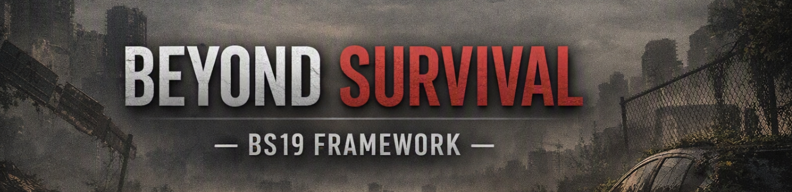
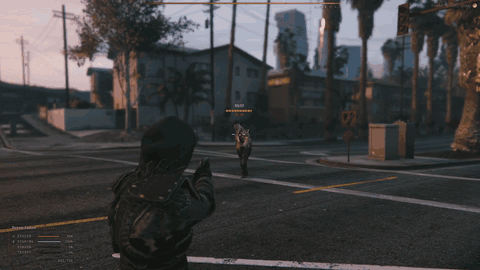
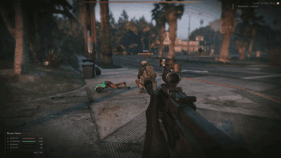
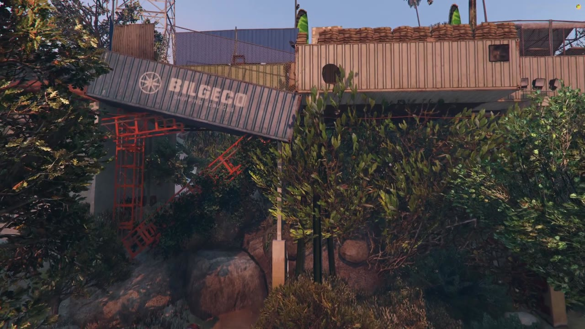
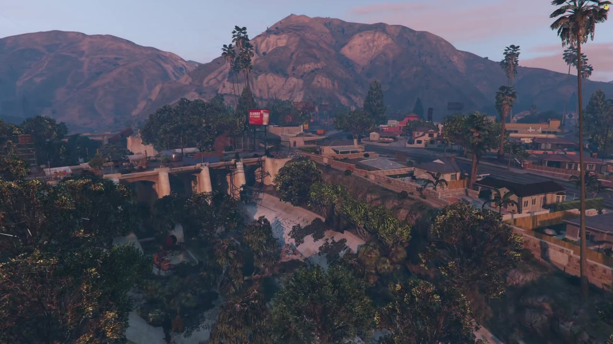
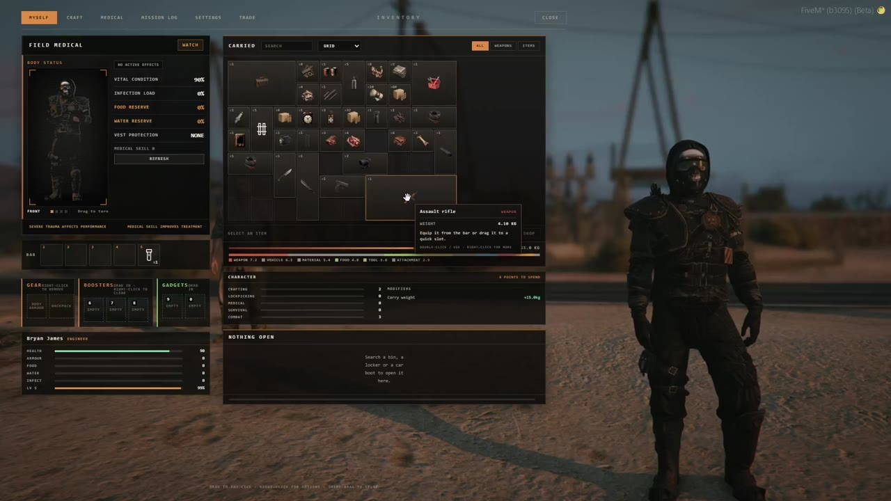
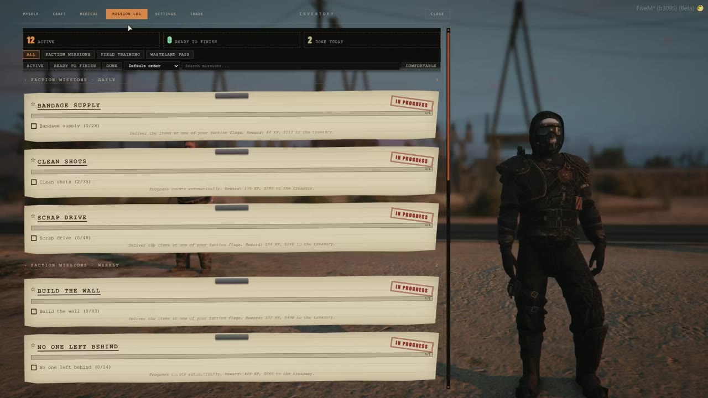
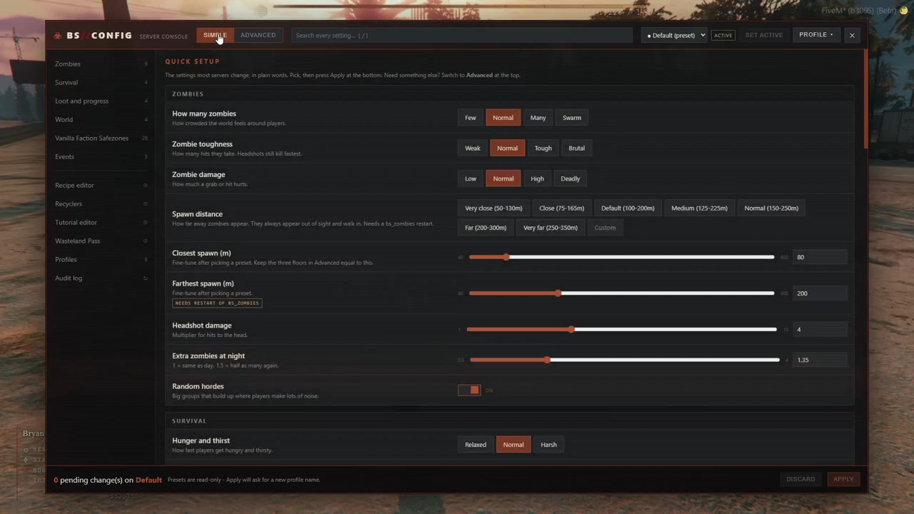
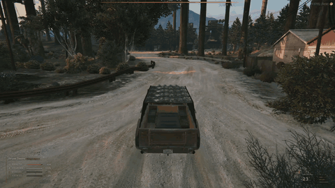

<div align="center">



**Standalone zombie survival RPG framework for FiveM**

No ESX, no QBCore. Every system is built from scratch to work together.

[](https://github.com/Arcainex/bs19)
[](https://fivem.net)
[](#install)
[](#languages)

[Website](https://bs19.org) &nbsp;&middot;&nbsp; [Docs](https://bs19.org/docs/) &nbsp;&middot;&nbsp; [Download](https://github.com/Arcainex/bs19) &nbsp;&middot;&nbsp; [Discord](https://discord.gg/aBkCNgmDZ) &nbsp;&middot;&nbsp; [Hosting](https://24racks.com/bs19)

<a href="https://www.buymeacoffee.com/xanderptv" target="_blank"></a>

BS19 is free and made by one person. If it saves you time, a coffee keeps it going. &hearts;

</div>

---

<p align="center">
  
  
</p>
<p align="center">
  
  
</p>
<p align="center">
  
  
  
</p>

## Try it live

Want to see it before installing? Join the public test server: open FiveM, press **F8** and type

```
connect 92.113.12.5:30120
```

## What's inside

**Zombies**
- Networked, server-owned zombies with senses: sight, noise and damage
- Hordes, crawlers and a drunk shamble. They never climb.
- Health, speed, damage and horde size scale with difficulty and player level

**Survival**
- Hunger, thirst, stamina and infection, a medical system and a downed state
- Death drops your gear into a lootable body
- Hunting: wildlife outside towns, predators that fight back, hides and pelts to tan or sell

**Economy and gear**
- Grid inventory, traders, recycling, mining, crafting and stashes
- Weapons with attachments, gadgets and boosters
- DayZ-style world vehicles that need parts before they run

**Factions and progression**
- Factions with safezones, ranks, treasury and bases
- Squads, skills and perks, faction reputation

**Building**
- Foundations, walls and doors from GTA props
- Faction locks or code locks, storage boxes
- Vending crates that keep selling while you're offline

**Operations and events**
- Power station: factions repair it and fight to hold it for a server-wide buff
- Control points to clear, capture and defend
- Mission chains with an in-game editor
- Airdrops, horde waves and military convoys

<p align="center"></p>

**For server owners**
- F1 config console with Default, Easy, Hardcore and PvP presets, plus your own profiles
- Admin menu, `/atlas` live zombie map, logged staff actions
- Every player picks their own language

## Install

In txAdmin choose **Remote URL Template** and paste:

```
https://raw.githubusercontent.com/Arcainex/bs19/main/recipe.yaml
```

Enter your license key and database, deploy, start. The framework creates its own tables on first start.

Full guide in your language:

<a id="languages"></a>

| | |
|---|---|
| English | [docs/INSTALL.en.md](docs/INSTALL.en.md) |
| Português | [docs/INSTALL.pt.md](docs/INSTALL.pt.md) |
| Deutsch | [docs/INSTALL.de.md](docs/INSTALL.de.md) |
| Polski | [docs/INSTALL.pl.md](docs/INSTALL.pl.md) |
| Türkçe | [docs/INSTALL.tr.md](docs/INSTALL.tr.md) |
| Español | [docs/INSTALL.es.md](docs/INSTALL.es.md) |
| Français | [docs/INSTALL.fr.md](docs/INSTALL.fr.md) |
| Italiano | [docs/INSTALL.it.md](docs/INSTALL.it.md) |
| Русский | [docs/INSTALL.ru.md](docs/INSTALL.ru.md) |

**Map (optional):** BS19 is built around The Apocalypse Project map, which is its own public resource and is not bundled here. Get it from [Arcainex/The-Apocalypse-Project](https://github.com/Arcainex/The-Apocalypse-Project), drop it in `resources/[map]` and uncomment its lines in `server.cfg`.

## Requirements

- Latest recommended FXServer artifacts with txAdmin
- MariaDB 10.6+ (or MySQL 8)
- OneSync on, game build 3095
- oxmysql (downloaded by the recipe)

## Hosting partner

<a href="https://24racks.com/bs19"></a>

Need a server? We run BS19 on **[24Racks](https://24racks.com/bs19)**. Good price for what you get, and it handles the framework without trouble.

## Beta

This is the first public build. The newest systems (building, operations, hunting, convoys) are only lightly tested, so expect rough edges. Known issues are listed in the [changelog](CHANGELOG.md). Found a bug? Tell us on [Discord](https://discord.gg/aBkCNgmDZ).

## License

Free to use and modify on your own servers. Selling it or re-uploading it is not allowed, and credit is required. See [LICENSE](LICENSE).

## Credits

- **XanderP** - BeyondSurvival
- **[The Apocalypse Project](https://github.com/Arcainex/The-Apocalypse-Project)** map - NoobyPiika, Savolent, SparksScripts (Total Apocalypse), SantosMods (Total Apocalypse Revisited) and the original map authors: denedwin, miltonalves, YopatPA, All_NightGamer, Limu, MrAvenue, Fr0zzty23, Michal10d, Crazy city, roosybigmods / Ultimate ShotHD, ManuGammer, RDK_Ulman
- **All-in-One Zombies Mega Pack** - zombie ped models
- **farusca** - Sounds for Simple Zombies
- **Nutria** - zombie crawl animation
- **Chadada** - apocalypse vehicles
- **winject** - Shield Mod (riot shield behaviour)
- **Norway174** - original zombie streaming ideas
- **overextended** - oxmysql

---

<div align="center">

Made by **XanderP** &nbsp;&middot;&nbsp; [bs19.org](https://bs19.org) &nbsp;&middot;&nbsp; [Facebook](https://www.facebook.com/bs19framework/) &nbsp;&middot;&nbsp; [Instagram](https://www.instagram.com/bs19_framework/)

</div>
